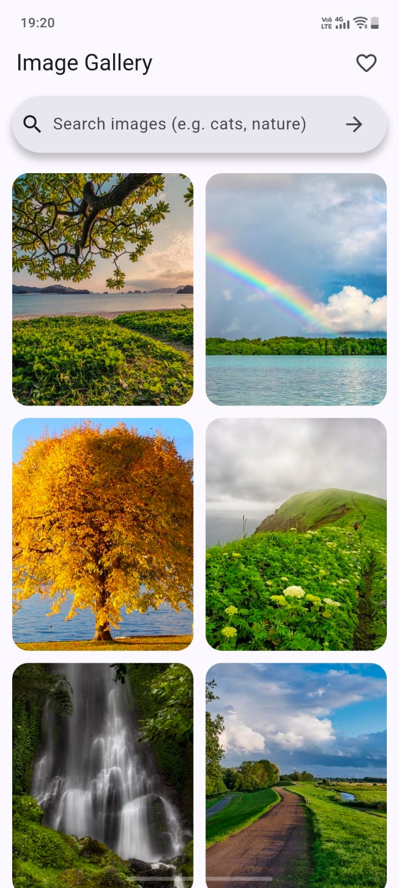
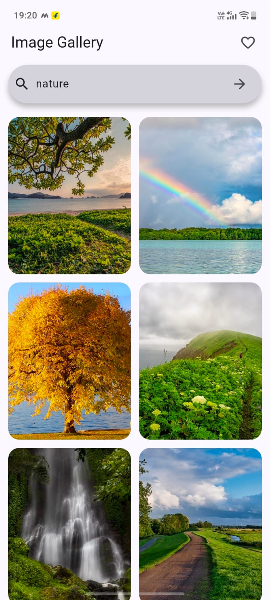
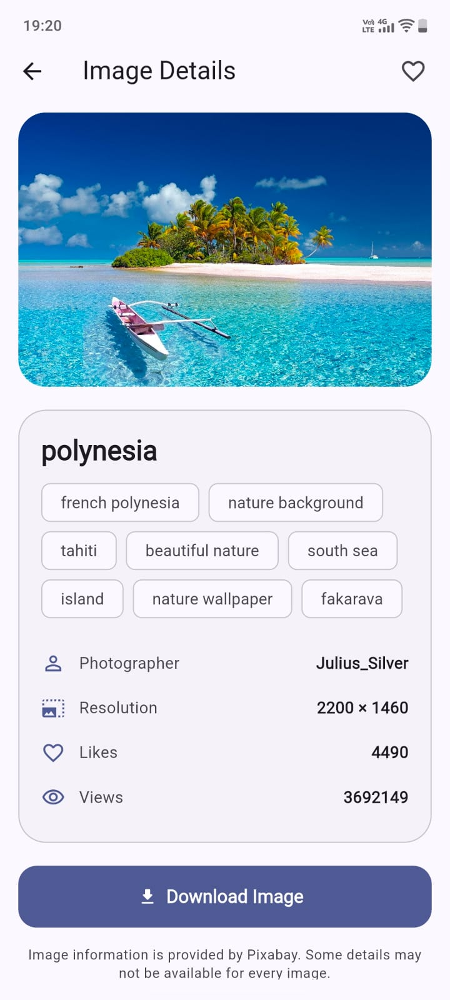
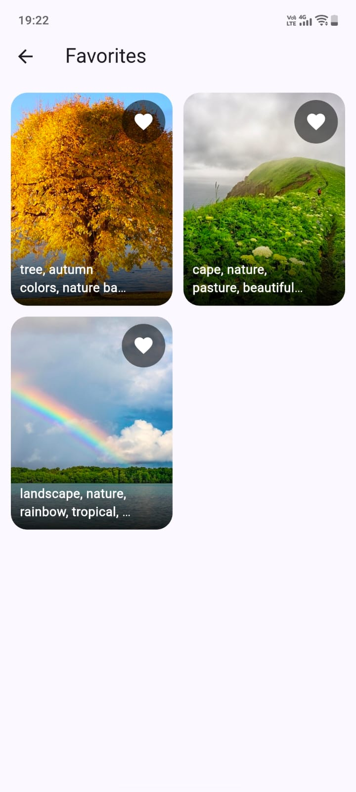

# Infinite Image Gallery — Flutter + Pixabay

A Flutter image gallery application built using the Pixabay API. The application supports image discovery, keyword search, infinite scrolling, image details, locally persisted favorites, and downloading images to the device gallery.

## Features

- Responsive image grid with image caching.
- Keyword-based image search using the Pixabay API.
- Page-based pagination and infinite scrolling.
- Loading, empty, and error states.
- Retry and pull-to-refresh.
- Image detail screen with available image metadata.
- Favorites persisted locally using SharedPreferences.
- Download images to the device gallery using Gal.
- State management using Provider and ChangeNotifier.

## Tech Stack

- Flutter and Dart
- Pixabay API
- Provider
- SharedPreferences
- Dio
- Gal
- flutter_dotenv

## Prerequisites

- Flutter SDK compatible with the project's `pubspec.yaml`.
- Android Studio or Visual Studio Code.
- An Android emulator or physical Android device.
- A valid Pixabay API key.

## Setup Instructions

### 1. Clone the repository

```bash
git clone YOUR_GITHUB_REPOSITORY_URL
cd infinite_image_gallery
```

Replace `YOUR_GITHUB_REPOSITORY_URL` with the actual GitHub repository URL.

### 2. Install dependencies

```bash
flutter pub get
```

### 3. Configure the Pixabay API key

Obtain an API key from the [Pixabay API documentation](https://pixabay.com/api/docs/).

Create a `.env` file in the project root:

```env
PIXABAY_API_KEY=YOUR_PIXABAY_API_KEY
```

Replace the placeholder with your actual API key.

Ensure `.env` is included in the Flutter assets configuration in `pubspec.yaml`, as required by the application's `flutter_dotenv` setup.

**Important:** Never commit the actual `.env` file or expose your API key in the public repository.

For reference, a `.env.example` file can contain:

```env
PIXABAY_API_KEY=YOUR_PIXABAY_API_KEY
```

The example file must contain only a placeholder, not a real API key.

### 4. Run the application

```bash
flutter run
```

If platform folders are missing, generate them using `flutter create .` after checking the existing project configuration. Do not run this command unnecessarily over an already configured project.

## Architecture and State Management

The application separates data models, API communication, state management, screens, and reusable widgets to improve maintainability and testability.

### Project Structure

```text
lib/
├── main.dart
├── models/
│   └── photo.dart
├── services/
│   └── pixabay_service.dart
├── providers/
│   ├── gallery_provider.dart
│   └── favorites_provider.dart
├── screens/
│   ├── gallery_screen.dart
│   ├── detail_screen.dart
│   └── favorites_screen.dart
└── widgets/
    ├── gallery/
    ├── favorites/
    ├── detail_download_button.dart
    ├── photo_info_card.dart
    └── photo_preview.dart
```

This is a high-level overview. Additional files may exist in these directories.

### State Management

The application uses Provider and ChangeNotifier.

- **Photo model:** Represents image data returned by the Pixabay API.
- **PixabayService:** Handles API requests and retrieves image data.
- **GalleryProvider:** Manages gallery data, search requests, pagination, loading states, errors, and refresh behavior.
- **FavoritesProvider:** Manages favorite images and local persistence using SharedPreferences.
- **Screens and widgets:** Display application data and respond to provider state changes.

This separation keeps API communication, application state, and presentation logic organized and easier to maintain and test.

## Screenshots

The following screenshots demonstrate the main application screens.

Save the actual screenshots in the `screenshots/` directory using the filenames below. The filenames in this section must match the image files in the repository.

### Gallery



### Search Results



### Image Details



### Favorites



Remove any screenshot entry for which an image file is not available. Use actual screenshots from the application.

## Run Tests

Run the Flutter static analyzer:

```bash
flutter analyze
```

Run the automated test suite:

```bash
flutter test
```

The last recorded local verification reported no analyzer issues and 15 passing tests. Re-run both commands after the final code changes to confirm the current results.

## Real-Device Testing

Real-device testing has been completed.

The final submission should be verified for the following core flows:

- Loading and displaying images.
- Searching for images.
- Loading subsequent pages while scrolling.
- Opening image details.
- Adding and removing favorites.
- Persisting favorites after restarting the application.
- Downloading images and handling required permissions.

Only report individual flows as verified if they have actually been tested.

## Build an Android APK

Generate a release APK using:

```bash
flutter build apk --release
```

The APK is normally generated at:

```text
build/app/outputs/flutter-apk/app-release.apk
```

Test the generated APK on a device before sharing it.

## Assumptions

- Pixabay is the source of gallery images and associated metadata.
- An internet connection is required to fetch images and search results.
- Some image metadata may not be available for every result.
- A valid Pixabay API key must be configured before running the application.

## Limitations

- Image availability and API responses depend on Pixabay.
- API usage limits may affect requests.
- Image download and permission behavior may vary across Android versions and devices.
- API keys included in client applications cannot be considered secret.

## Incomplete Features and Known Issues

Document any known bugs, unimplemented requirements, or partially verified features here.

If no required features remain incomplete after final verification, state that explicitly. Do not claim that all features are complete unless they have been tested.

## Windows Gradle Memory Troubleshooting

If Gradle fails because of native memory allocation:

1. Inspect the complete Gradle error message.
2. Check the memory settings in `android/gradle.properties`.
3. Adjust the Gradle heap and worker settings to suit your machine.
4. Close memory-intensive applications.
5. Ensure Windows virtual memory is enabled.
6. Retry the build and investigate further if the error persists.

Avoid setting an excessively large Gradle heap on a low-memory system.
